<div align="center">

# ☕ Kaffeebibliothek

[English](README.md) · **Deutsch**

**Deine Kaffees wie eine Bibliothek, und eine Espressomaschine, die mitdenkt.**

Selbst gehostet · ein Container · SQLite · kein Konto, kein Tracking

[](LICENSE)
[](https://nodejs.org)
[](https://react.dev)
[](https://nodejs.org/api/sqlite.html)
[](compose.yaml)
[](#)

[Projektseite](https://yatheria030.github.io/kaffeebibliothek/) · [Schnellstart](#-schnellstart) · [Funktionen](#-funktionen) ·
[Integrationen](#-integrationen) · [Konfiguration](#%EF%B8%8F-konfiguration)

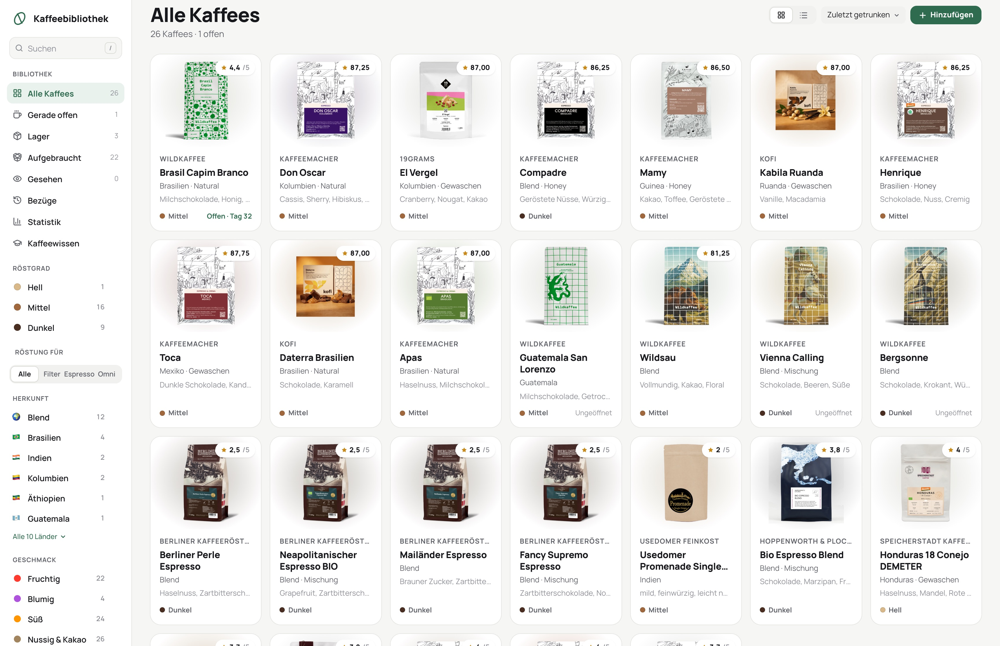

</div>

Die meisten Kaffee-Apps sind Notizbücher: Bohne eintragen, Sterne geben, vergessen. Die Kaffeebibliothek fängt da erst an.
Sie liest neue Kaffees selbst aus dem Shop, holt jeden Mahlvorgang von der Mühle und jeden Shot von der Maschine, verbindet
beides zu einem Bezug und sagt dir für den nächsten Shot, wo der Mahlgrad hin muss. Mit Begründung, in Mikrometern.

## Inhalt

- [Highlights](#-highlights)
- [Funktionen](#-funktionen)
- [Integrationen](#-integrationen)
- [Unter der Haube](#-unter-der-haube)
- [Schnellstart](#-schnellstart)
- [Konfiguration](#%EF%B8%8F-konfiguration)
- [Sicherung und Export](#-sicherung-und-export)
- [Entwicklung](#-entwicklung)
- [Datenschutz](#-datenschutz)
- [Lizenz](#-lizenz)

## ✨ Highlights

- 🔎 **Kaffee in Sekunden erfasst**: Shop-Link, Name oder Foto der Packung, die Anthropic-API füllt den Rest. Live zu sehen
- ✂️ **Packungsfotos automatisch freigestellt**: einfarbiger Hintergrund raus, weiche Schatten bleiben, alle Packungen gleich groß im Regal
- 🧭 **Mahlkompass**: Startwert für jede neue Tüte auf der Skala deiner Mühle, lernt lokal aus deinen eigenen Bezügen
- ⚙️ **Mühle und Maschine tragen selbst ein**: optimiert für Mahlkönig E64 WS und Decent DE1, offen für andere Maschinen und Mühlen, dazu Home Assistant
- 📦 **Lager mit Trinkfenstern**: weiß, welche Tüte als Nächstes dran ist
- 📊 **SCA-Cupping, Statistik und Kosten**: vom Kurzurteil bis zum vollen Bogen, vom Preis je Tasse bis zur Weltkarte
- 📚 **Kaffeewissen**: eingebautes Wiki, verlinkt mit deinen Kaffees
- 🌗 **Hell und dunkel**, vom Handy bis zum MacBook 16", installierbar als App
- 🔒 **Alles bei dir**: ein Container, eine SQLite-Datei, ein Bilderordner

## 🧩 Funktionen

### Bibliothek
- Regal mit freigestellten Packungsbildern oder kompakte Liste, hell und dunkel
- Ansichten in der Seitenleiste: **Alle**, **Gerade offen**, **Lager**, **Aufgebraucht**, **Gesehen**, **Archiv**
- Filter nach Röstgrad, „Geröstet für“ (Filter, Espresso, Omni), Herkunftsland, Geschmack und Mindest-Score
- Suche (Taste <kbd>/</kbd>), Sortierung nach zuletzt getrunken, bestem Score, Name, Röstdatum oder zuletzt hinzugefügt
- „Zuletzt angesehen“ in der Seitenleiste, Filter bleiben gespeichert
- Kaffee hinzufügen per Knopf oder einfach Bild bzw. Link auf die Seite ziehen
- „Gesehen“ für Kaffees, die dir irgendwo begegnet sind: Sie ziehen mit der ersten Packung in die Bibliothek um

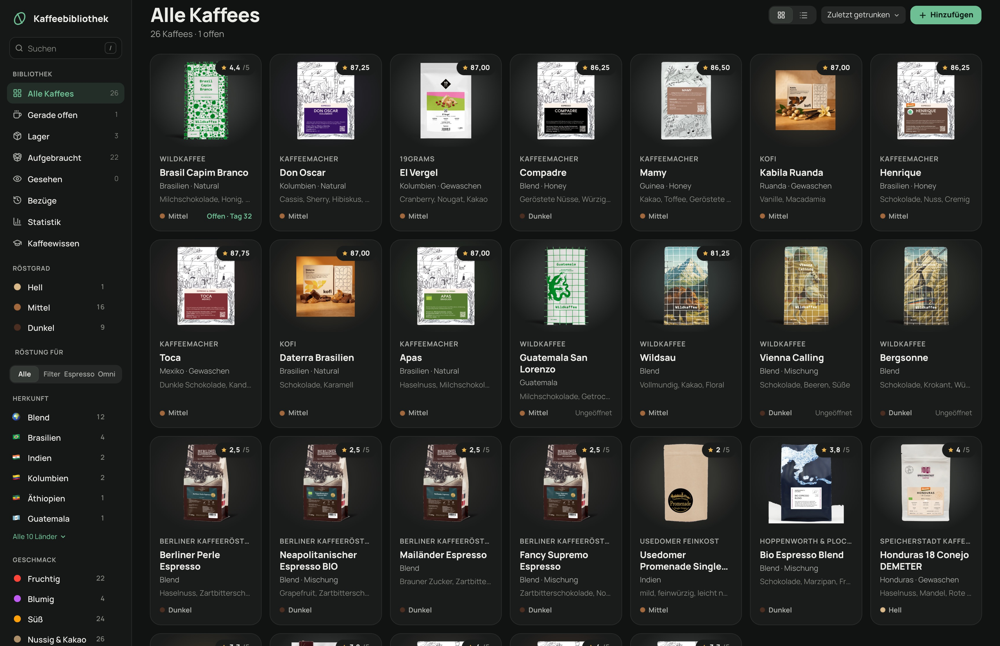

### Kaffee erfassen
- Auslesen per **Shop-Link, Name oder Foto**: Websuche, gelesene Seiten und fertige Felder erscheinen live
- Oder **im Hintergrund**: weiter in der App stöbern, unten rechts steht der Fortschritt, eine Meldung sagt, wann er fertig ist
- Erfasst Rösterei, Herkunft (Land, Region, Farm, Produzent, Höhe), Varietäten, Aufbereitung mit Zusatz (Fermentation,
  Trocknung, Honey-Farbe, Decaf-Verfahren), Röstgrad, „Geröstet für“, Aromen, Cup Score, Packung und Preis
- **Röster-Rezepte** von der Shopseite übernehmen
- Schreibweisen bekannter Röstereien werden zusammengeführt („Rösterei Muster GmbH“ = „Muster“)
- **Packungsbilder werden automatisch freigestellt und ausgerichtet**: einfarbiger Hintergrund raus, Schatten bleiben weich, alle
  Packungen gleich groß im Regal. Feinschliff im Bild-Editor „Ausrichten“ mit Hilfsraster
- Ohne API-Key geht alles von Hand

| Live | Im Hintergrund |
|---|---|
| 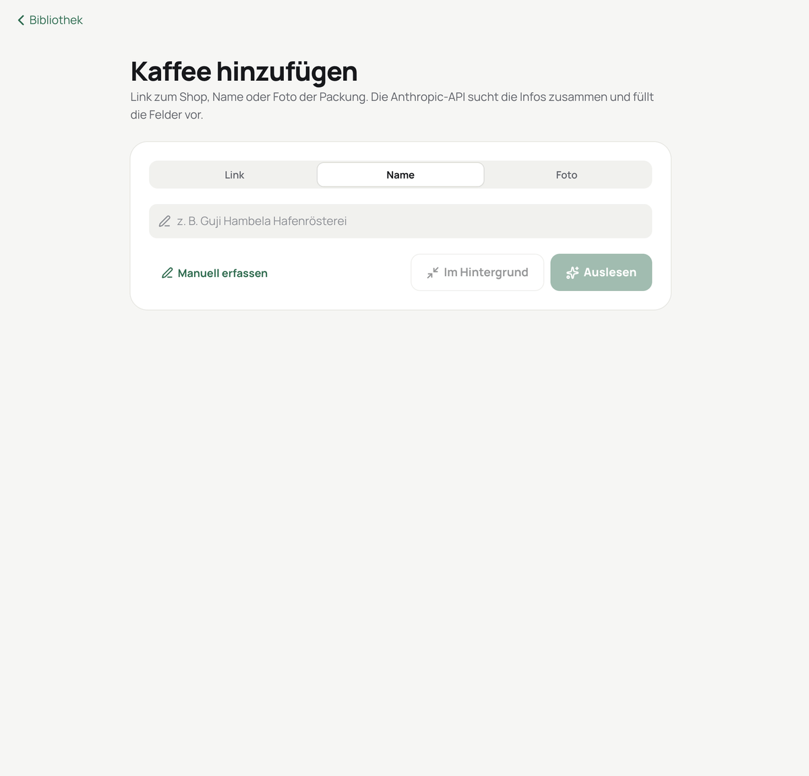 | 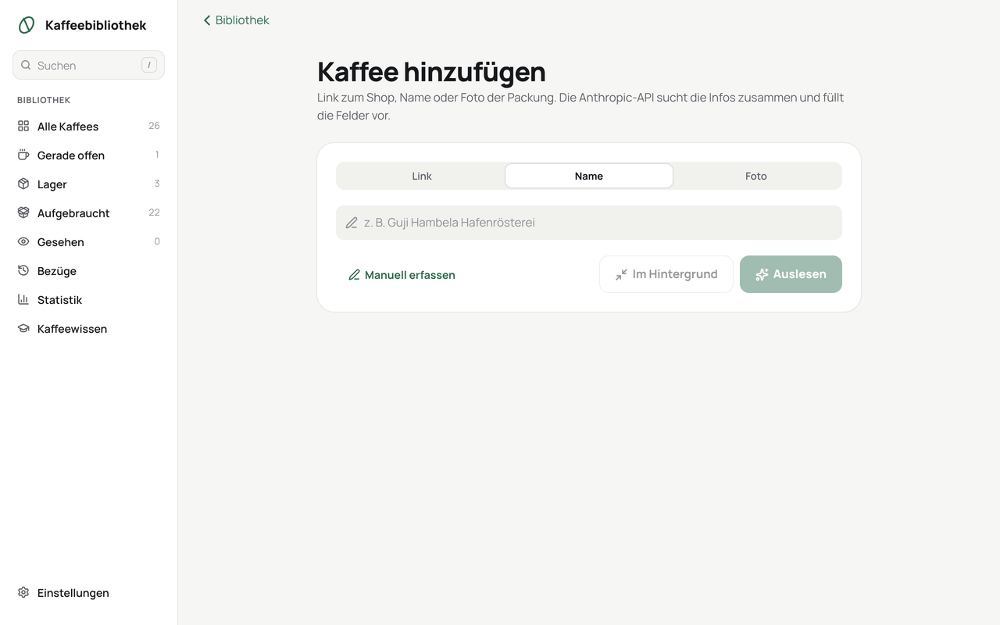 |

### Kaffee-Detail
- Kennzahlen: bester Score, Bezüge, Tage seit Röstung mit Frische-Zustand, gelungene Bezüge bzw. Ø Sterne
- **Chargen**: jede Packung mit Röstdatum, Status (ungeöffnet, offen, aufgebraucht, nachgetragen), Gewicht und Preis
- **Geschmack**: Radar der SCA-Attribute je Rezept oder Schnellbewertungen mit Kurzurteilen und Aromen
- **Einstellen**: Ziel, Kompass-Pfad, Tipp für den nächsten Shot, Verlauf des Mahlgrads über die Tüte
- **Verlauf** nach Röstalter, Bezugszeit, Temperatur oder Verhältnis
- Details in Gruppen (Herkunft, Bohne, Röstung, Kauf) mit €/kg und Preis je Tasse
- Begriffe wie Aufbereitung, Varietät, Land und Röstgrad verlinken ins Wiki
- Eigenes **Decent-Profil** je Kaffee (siehe [Integrationen](#-integrationen))

| Hell | Dunkel |
|---|---|
| 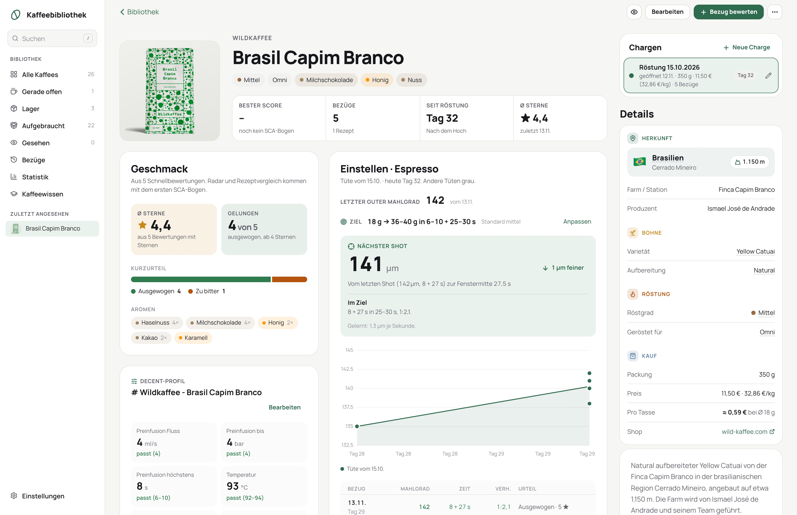 | 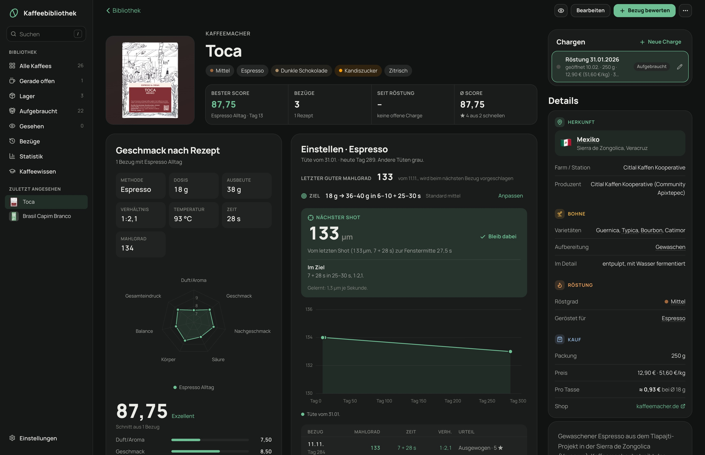 |

### Bezüge bewerten
- Dialog in Schritten wie am Gerät: **Rezept und Parameter → Mahlgrad → Wie lief er?**
- Mahlvorgang der Mühle und Shot der Maschine werden automatisch übernommen und über die Uhrzeit gepaart, „Rückgängig“ inklusive
- **Mahlgrad-Regler**: Maßband mit Schwung, Antippen, Mausrad, Tastatur, ±1/±5 und Sprung-Chips (Tipp, letzter guter, Kompass, letzter)
- **Shot-Auswertung** für Espresso: Verhältnis, Zeit, Preinfusion und nächster Mahlgrad groß, mit Messleisten gegen das Ziel
  und einem Diagramm aller Shots der Tüte
- Bewertung **schnell** (Kurzurteil wie „ausgewogen“, „zu sauer“, „zu bitter“, optional 1–5 Sterne, Aromen) oder nach dem
  **SCA-Cupping-Bogen** (7 Attribute, Gleichmäßigkeit, Sauberkeit, Süße, Defekte) mit **Aromarad**
- Preinfusion wird getrennt von der Bezugszeit geführt („8 + 29 s“)
- Sterne und SCA-Scores zählen getrennt, damit schnelle Bewertungen keine Scores verwässern

| Schnell: Kurzurteil, Sterne, Shot-Auswertung | SCA-Bogen: Score, Stufe, Radar |
|---|---|
| 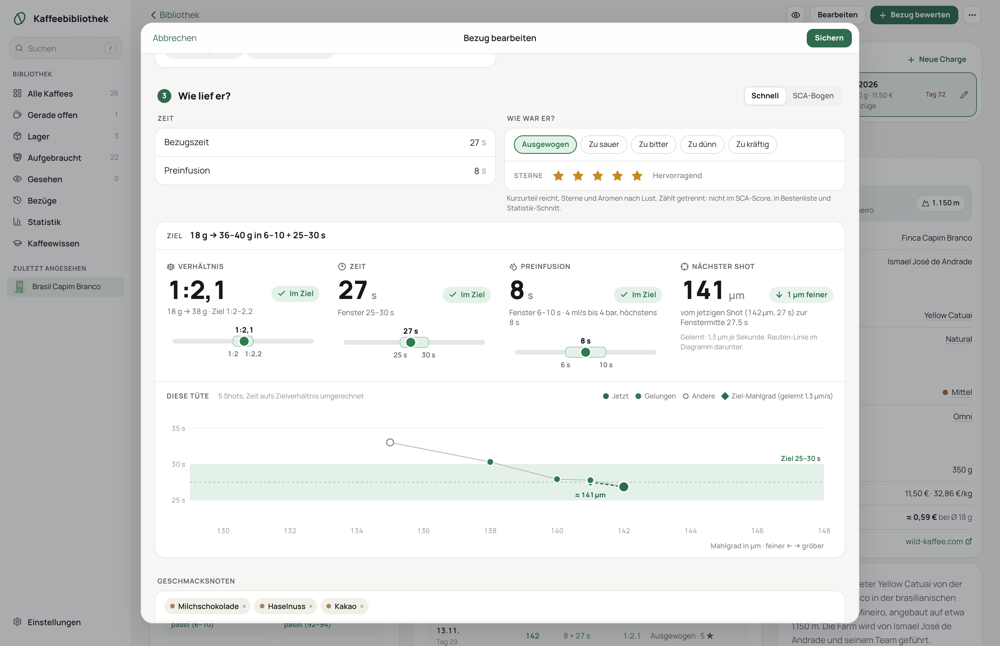 | 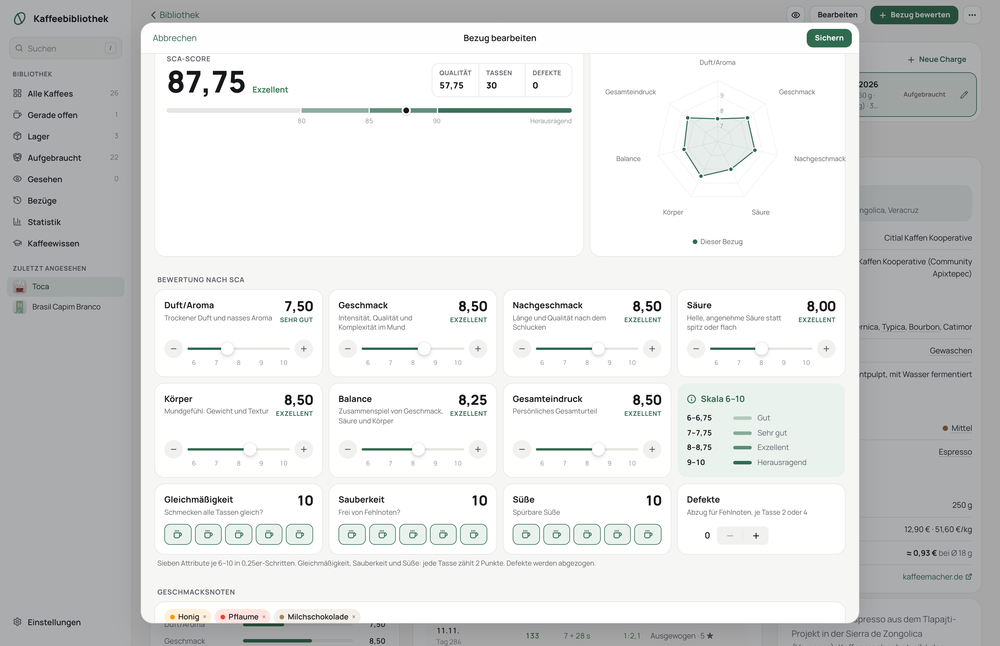 |
| **Mahlgrad-Regler und nächster Shot** | **Aromarad (dunkel)** |
| 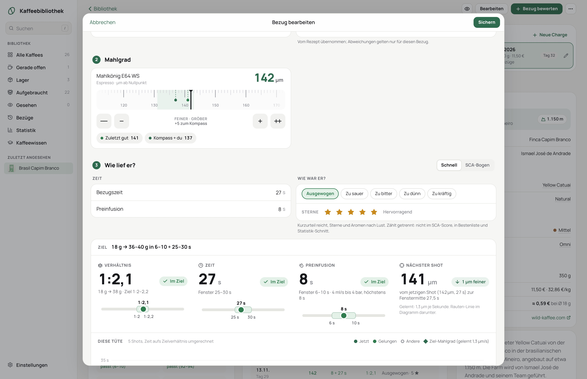 | 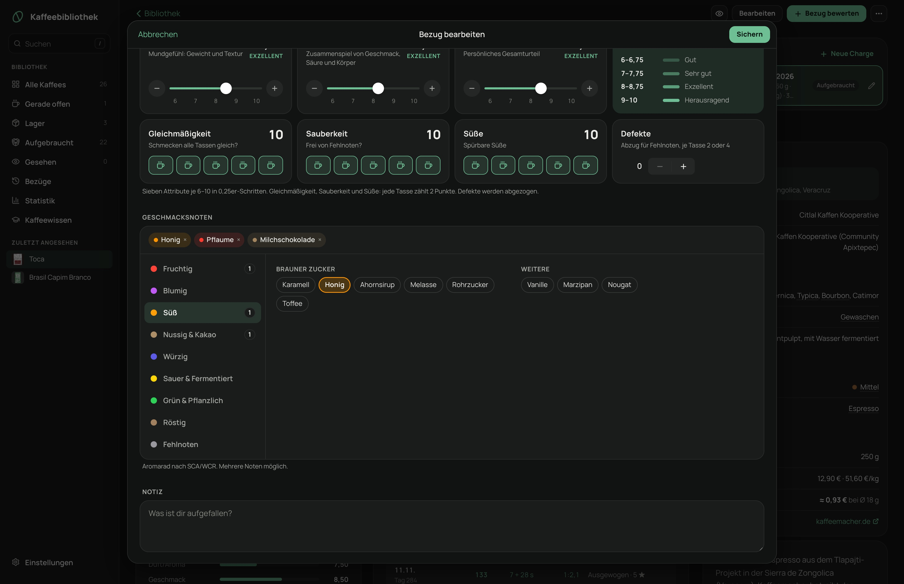 |

### Espresso-Ziel und Mahlkompass
- **Ziel je Röstgrad**: Dosis, Verhältnis, Zeit-, Preinfusions- und Temperaturfenster, je Kaffee feldweise anpassbar
- **Startwert für eine neue Tüte** auf der Skala deiner Mühle aus festen Regeln: Röstgrad, Filter oder Espresso, Höhe,
  Aufbereitung, Decaf, Robusta, Röstalter
- **Lernt aus deinen Tüten**: Ridge-Regression über Röstgrad, Höhe, Röstalter, Kaffee, Aufbereitung, Land, Rösterei und
  Varietäten, Kreuzvalidierung Tüte für Tüte, komplett lokal
- **Folgt jedem Shot**: Zeit aufs Zielverhältnis umgerechnet, über die gelernte Steigung (µm je Sekunde) in einen Mahlgrad übersetzt,
  berücksichtigt die Alterung im Hopper
- Geschmack (sauer, bitter) verschiebt den Wert je Kaffee, gebremst
- **Hinweise aus festen Regeln**: zu schnell, zu langsam, im Fenster und trotzdem sauer, Preinfusion verlängern oder kürzen
- Jede Zahl ist im Kompass-Pfad nachvollziehbar

### Rezepte
- Rezepte als Vorlagen (Methode, Mühle, Dosis, Wasser bzw. Ausbeute, Temperatur, Mahlgrad, Zeit)
- Rezeptwerte werden in den Bezug kopiert, Abweichungen gelten nur für diesen Bezug
- Vergleich nach Rezept: Radar, Attribute und Score je Rezept

### Lager und Frische
- Alle ungeöffneten Packungen mit **Trinkfenster** (trinkbereit, am besten, noch gut) nach recherchierten Röster-Werten
  für Filter, Espresso und Omni × hell, mittel, dunkel, in den Einstellungen anpassbar
- Sortiert nach Dringlichkeit, oben steht **„Als Nächstes öffnen“**
- Ohne Röstdatum, „Geröstet für“ oder Röstgrad heißt es „nicht bewertbar“, nie geraten
- **Gefrierfach** je Packung: einfrieren und auftauen mit Datum, die Tage im Gefrierfach zählen nicht zum Röstalter.
  Eingefrorene Packungen stehen in einem eigenen Abschnitt mit dem Trinkfenster „wenn heute aufgetaut“
- **„Einfrieren empfohlen“** für jede ungeöffnete Packung nach der nächsten, ruhende erst nach ihrer Ruhezeit. Beim Auftauen
  nennt die App die Auftauzeit nach Packungsgröße

| Hell | Dunkel |
|---|---|
| 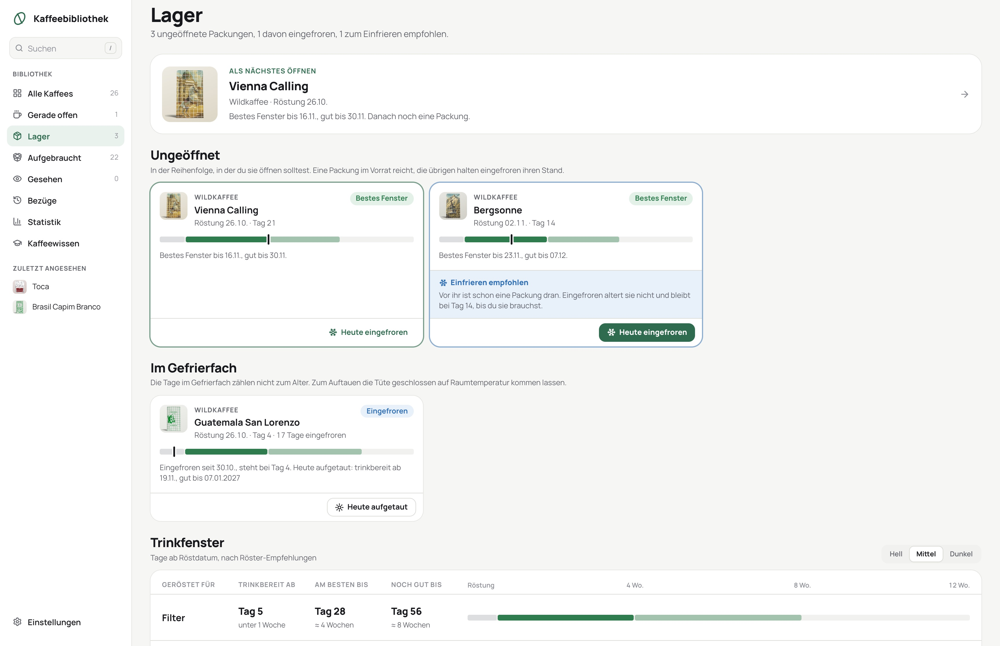 | 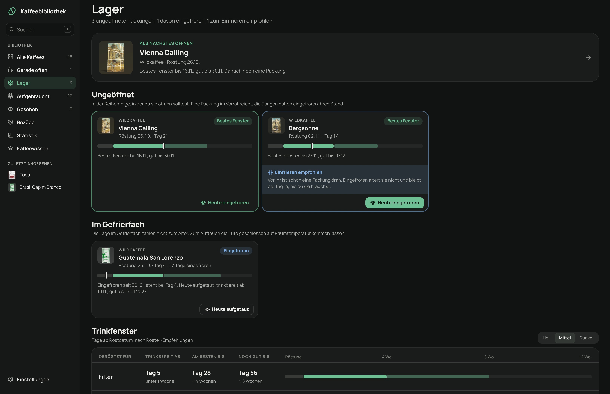 |

### Bezüge
- Alle Bezüge über alle Kaffees, nach Tagen gruppiert, mit Rezept, Mahlvorgang und Shot
- **Abweichung vom Rezept** je Wert in Prozent (Mahlgrad, Dosis, Ausbeute, Zeit, Temperatur), grün bis 5 %, rot ab 15 %
- Kacheln „Nach Rezept“ mit Ø-Abweichung filtern die Liste
- Freie Mahlvorgänge der Mühle der letzten 90 Tage, damit nichts verloren geht

| Hell | Dunkel |
|---|---|
| 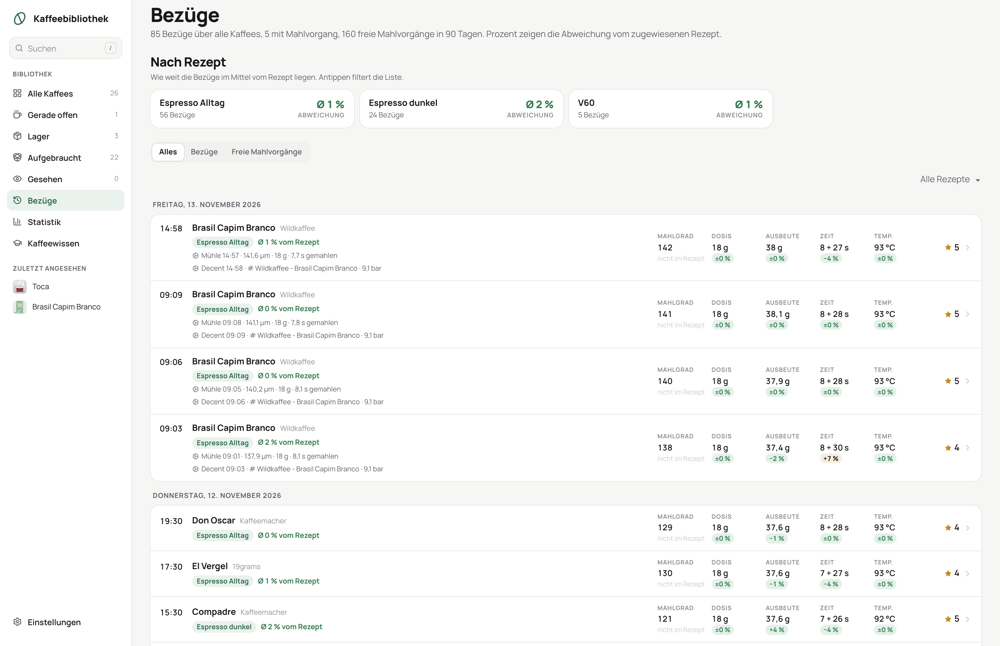 | 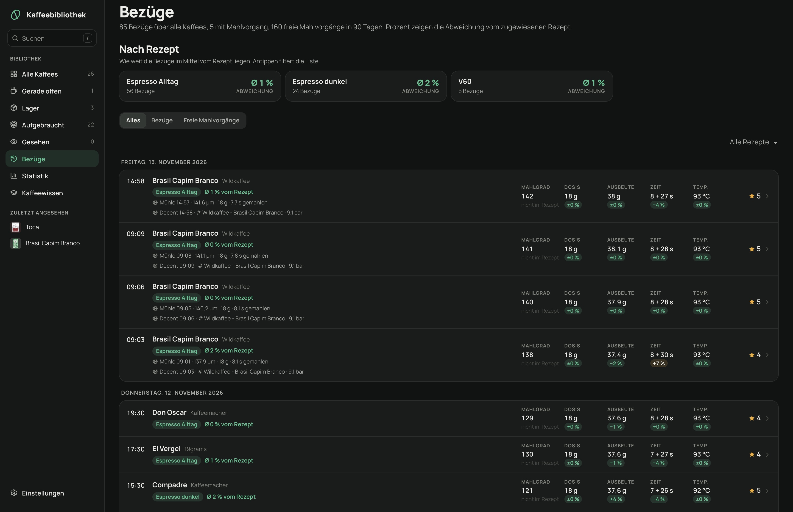 |

### Statistik
- Kennzahlen: Kaffees, Bezüge, Ø Score, verbrauchte Menge
- Bestenliste, Bezüge je Monat
- **Kosten**: €/kg, Preis je Tasse, Ausgaben je Monat, Preis je Rösterei, „Teuer gleich besser?“
- Verteilung nach Herkunft (mit **Weltkarte**, Klick filtert die Bibliothek), Aufbereitung, Röstgrad und Methode
- **Was passt zu mir?**: Geschmacksprofil aus deinen Bewertungen. Auf Wunsch sucht die Anthropic-API in den Shops deiner
  Röstereien nach passenden Kaffees, „Unter Gesehen ablegen“ mit einem Klick

| Hell | Dunkel |
|---|---|
| 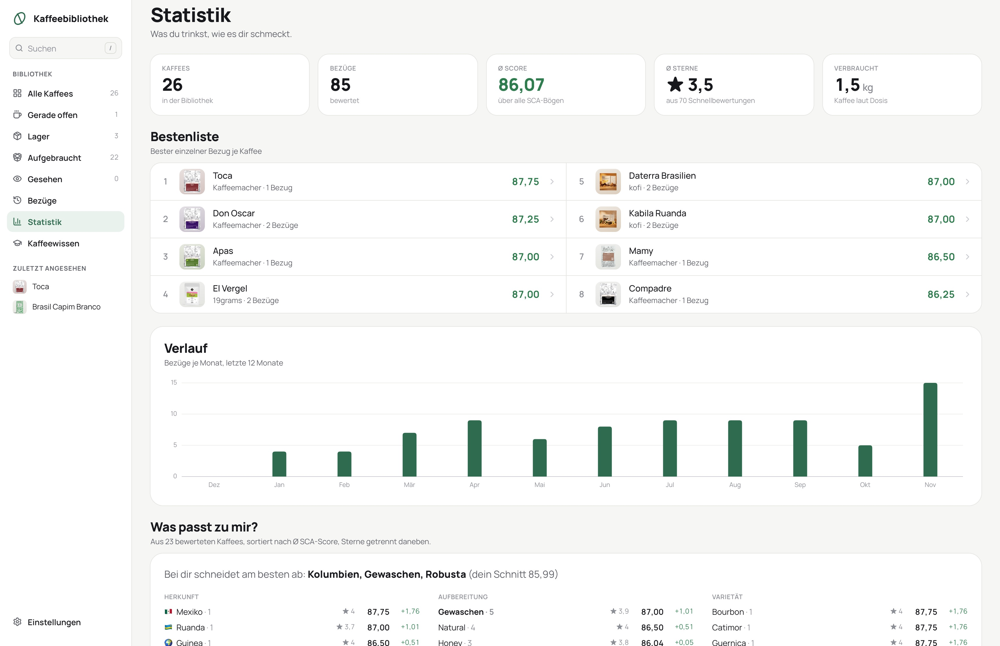 | 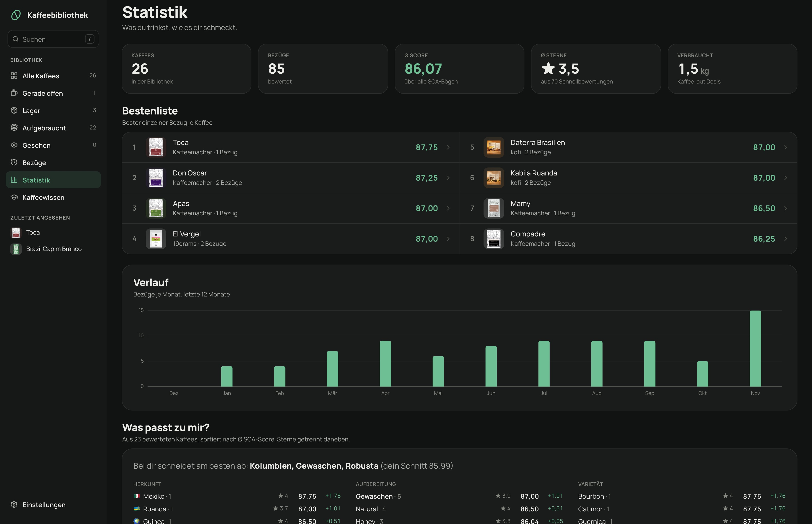 |

### Kaffeewissen
- Eingebautes Wiki mit über 50 Artikeln zu Grundlagen, Herkunft, Varietäten, Aufbereitung, Röstung, Zubereitung und Verkostung
- Steckbrief und Geschmacksprofil je Artikel, passende Kaffees aus deiner Bibliothek
- SCA-Bogen, Aromarad, Ruhezeit und Mahlkompass lesen direkt aus der Logik der App

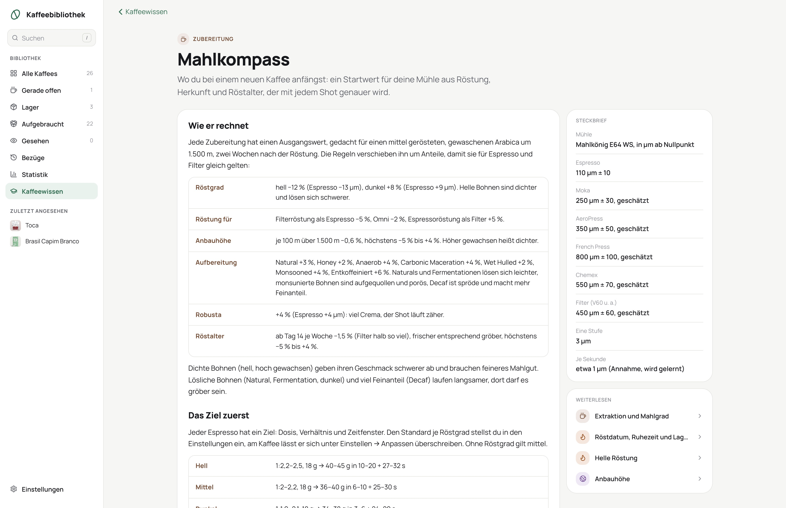

### Rund um die App
- **Erste Schritte**: Assistent beim ersten Start, geht alle Einstellungen durch (Pflicht, optional, empfohlen) mit Übersicht am Ende
- **Einstellungen** in Bereichen: Mühle, Maschine, Espresso & Rezepte, Lager & Frische, Anthropic-API, Daten & Sicherung, Allgemein
- **Installierbar** als App (PWA) auf Handy und Desktop
- **Dark Mode** folgt dem System, Layout von 390 bis 1728 px Breite
- Tastatur und Fokus durchdacht: Dialoge halten den Fokus, <kbd>/</kbd> springt in die Suche

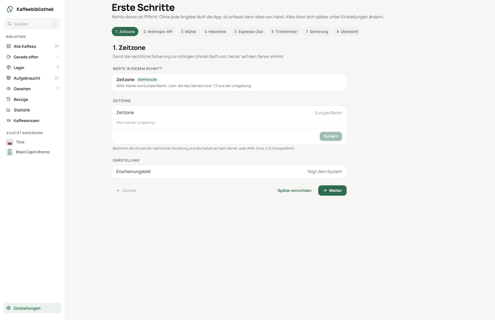

<p align="center">
  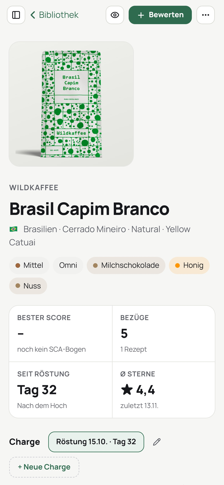
  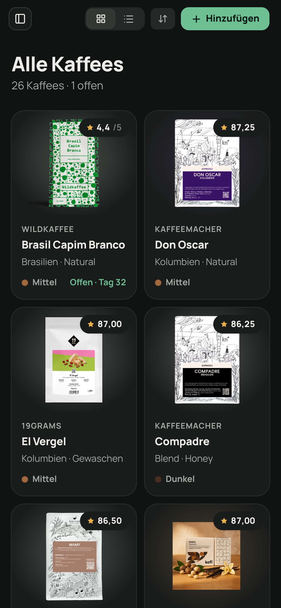
</p>

## 🔌 Integrationen

Alle Integrationen sind optional und werden in den Einstellungen eingerichtet.

> [!NOTE]
> **Gebaut und optimiert für die Decent DE1 und die Mahlkönig E64 WS**, weil die App mit genau diesem Setup entstanden ist.
> Sie ist offen für mehr: Jede Espressomaschine und jede Mühle, die ihre Shots oder Mahlvorgänge hergibt (API, lokale
> Schnittstelle, Export oder Home-Assistant-Integration), lässt sich anbinden. Du hast so ein Gerät? Mach ein Issue auf, dann bauen wir es ein.

| Integration | Was sie bringt | Wie |
|---|---|---|
| **Anthropic-API** | Kaffees auslesen, Röster-Rezepte holen, „Was passt zu mir?“ | API-Key in den Einstellungen, Modell wählbar |
| **Mahlkönig E64 WS (Heimnetz)** | Jeder Mahlvorgang mit Mahlgrad, Dosis und Dauer | Adresse der Mühle eintragen. Nur lesend, an der Mühle wird nichts geändert |
| **Mahlkönig Sync (Cloud)** | Mahlvorgänge über die Cloud, wenn Grind-by-Sync genutzt wird | E-Mail, Passwort, Store-ID wird automatisch gefunden |
| **Decent DE1** | Jeder Shot mit Druck-, Fluss- und Gewichtskurve, Archiv aller Shots und Profile | Plugin als ZIP aus den Einstellungen laden und in der de1app installieren |
| **Decent-Profil je Kaffee** | Preinfusion, Temperatur, Druck, Stopp-Gewicht und Dosis passend zum Ziel, Abgleich mit dem Tablet in beide Richtungen | Automatisch mit dem Plugin. Vorhandene Profile werden nie geändert |
| **Home Assistant** | Temperaturen, Wasserstand, Zustand live, Maschine und Dampf schalten | Adresse und Token. Nutzt die Entitäten des MQTT-Plugins der de1app |

## 🔬 Unter der Haube

Was im Hintergrund passiert, damit es sich vorne einfach anfühlt.

### Packungsbilder
- **Automatisches Freistellen** im Browser (`web/src/lib/packshot.ts`): Die Hintergrundfarbe wird als Median der Randpixel
  geschätzt, eine Flutfüllung vom Rand aus erfasst alles, was dieser Farbe entspricht. Schatten werden dabei nicht hart
  abgeschnitten, sondern zu halbtransparentem Schwarz, sodass sie auf jeder Kachelfarbe natürlich wirken. Läuft die Füllung bei
  einer hellen Tüte ohne Kontur zu weit in die Packung, wird ihr Inneres gesperrt und neu gefüllt
- **Automatisches Ausrichten**: Die Packung wird als Umriss der vom Hintergrund abweichenden Pixel gefunden und auf ein
  quadratisches Bild mit festen Rändern gesetzt, damit im Regal alle Packungen gleich groß stehen
- Fremde Bilder laufen über einen Proxy des Servers, der nichts speichert, damit das Canvas sie auslesen darf
- Nicht freigestellte Bilder blendet die Oberfläche im hellen Modus per `mix-blend-mode: multiply` in die Kachel ein,
  freigestellte erkennt sie an transparenten Ecken

### Auslesen
- Die Antwort der Anthropic-API wird als **NDJSON-Stream** an die Oberfläche durchgereicht: Websuche, gelesene Seiten und halbfertige
  Felder erscheinen live, noch bevor das Modell fertig ist
- Jedes Auslesen ist ein **Auftrag im Server**: Neu laden, Seite wechseln oder Handy sperren unterbricht es nicht, beim Öffnen wird
  der bisherige Verlauf nachgespielt
- Strukturierte Ausgabe über ein Tool (`save_coffee`), validiert mit zod. Bekannte Röstereien bekommt das Modell mit, damit
  Schreibweisen zusammenfinden
- Röstereinamen werden ohne Füllwörter (Rösterei, Coffee, GmbH), Leerzeichen und Akzente verglichen, Aufbereitungen auf
  einheitliche Schreibweisen gebracht

### Mahlkompass
- **Zwei Schichten**: feste Regeln als Anteil vom Ausgangswert der Mühle, darüber ein gelerntes Modell, das nur die Abweichung
  von diesen Regeln lernt. So ist schon die erste Tüte brauchbar, und jede weitere macht es genauer
- **Ridge-Regression** über Tüten mit gelungenem Bezug, jede Tüte zählt gleich viel. λ wird per **Leave-one-bag-out**
  aus 9 Stufen gewählt, die Normalgleichungen werden dünn aufgebaut und einmal je Tüte für alle λ gelöst. Unter 3 Tüten bremst ein
  Mittel mit einer halben Tüte Null
- **Steigung k** (µm je Sekunde) mit Vorwissen je Mühle, aus Shot-Paaren derselben Tüte nachgeschärft. Die Tage seit dem ersten
  Shot gehen als zweite Größe ein, sonst würde die Alterung der Bohnen im Hopper k verfälschen
- Bezugszeiten werden aufs Zielverhältnis umgerechnet, damit ein 1:2,3 und ein 1:2 vergleichbar sind
- Das gelernte Modell bleibt im Speicher, bis sich die Datenbank ändert (`total_changes()` und `data_version`). Gerechnet wird in
  einem eigenen Worker-Thread, der Server antwortet währenddessen weiter, nach Änderungen wird vorgerechnet

### Mühle und Maschine
- **Mahlkönig E64 WS im Heimnetz**: Die App lädt die SQLite-Datenbank der Mühle über deren Weboberfläche und liest daraus
  die Mahlvorgänge. Spülen, Leerlauf und Vormahlen werden über Gewicht, Durchsatz und die Siebträger-Erkennung aussortiert
- **Paarung über die Zeit** (`shared/pairing.ts`): Ein Shot nimmt den jüngsten offenen Mahlvorgang der 15 Minuten davor, mit
  Toleranz für abweichende Uhren. Wählst du eins von Hand, kommt das andere dazu
- **Decent-Plugin** in Tcl für die de1app: schickt jeden Shot nach dem Bezug, dazu das ganze Archiv (`history/`, `history_v2/`,
  Profile) mit Wiederholung und Merkliste gesendeter Dateien. Das alte Tcl-Format der Shots wird im Server zerlegt
- Shot-Kurven werden auf höchstens 250 Punkte ausgedünnt, die Preinfusion wird aus den Zustandswechseln des Profils bestimmt
- **Profile in beide Richtungen**: Je Kaffee ein eigenes Profil, abgeglichen mit dem Tablet, es gilt die jüngere Änderung.
  Das Plugin schreibt nur eigene Dateien und ändert nie ein vorhandenes Profil
- **Home Assistant**: Entitäten der Maschine werden per Muster erkannt (Zustand, Temperaturen, Wasser, Schalter) und gecacht

### Daten
- **SQLite über `node:sqlite`**, ohne native Abhängigkeit. Migrationen als SQL oder als Funktion für Datenumbauten, Stand in `user_version`
- **Sicherung** als selbst gebautes ZIP (zlib), mit `VACUUM INTO` für einen stimmigen Stand der Datenbank im laufenden Betrieb
- **Einstellungen** mit klarer Reihenfolge: Wert in der App, sonst Umgebung, sonst eingebauter Standard. Timer takten bei Änderung neu
- Schlüssel und Passwörter verlassen den Server nie, die API zeigt nur einen Hinweis wie `…a1b2`
- Eingaben werden geprüft (Datum, Zeitpunkte, Größe von Anfragen und Bildern). Bilder von Links lädt der Server nur aus dem
  öffentlichen Internet und prüft jede Weiterleitung
- Tage zählen in der Ortszeit, ein Bezug um 0:30 gehört zum neuen Tag

### Oberfläche
- React 19, TanStack Query, Hash-Router. Links auf einen Kaffee laden das Detail schon bei Maus, Fokus oder Antippen vor
- **Container Queries** statt Fensterbreite, damit Raster zur tatsächlichen Spaltenbreite passen
- Diagramme (Radar, Verlauf, Säulen, Shot-Kurven) als eigenes SVG, die ihre Breite messen statt zu skalieren, damit die Schrift auf
  dem Handy lesbar bleibt
- Weltkarte aus world-atlas in Equal-Earth-Projektion, nachgeladen per dynamischem Import, Ländernamen über `Intl.DisplayNames`
- Abgestürzte Seiten fängt eine Fehlergrenze ab, die Seitenleiste bleibt benutzbar
- Installierbar als PWA, `index.html` ohne Cache, Assets mit Hash unbegrenzt

## 🚀 Schnellstart

### Docker

```bash
git clone https://github.com/Yatheria030/kaffeebibliothek.git
cd kaffeebibliothek
docker compose up -d --build
```

Dann http://localhost:8790 öffnen. `compose.yaml` legt die Datenbank und Bilder in `./data` und die nächtlichen Sicherungen
in `./backups` ab.

### Node

Voraussetzung: Node 24.

```bash
npm ci
npm run build
npm start
```

Beim ersten Start öffnet sich **Erste Schritte**. Pflicht ist nichts: Ohne jede Angabe läuft die App, neue Kaffees erfasst
du dann von Hand.

## ⚙️ Konfiguration

Alle Werte stehen in den Einstellungen der App und liegen in der Datenbank. Ein leeres Feld heißt Standard. Umgebungsvariablen
gelten nur, solange in der App nichts eingetragen ist.

| Wert | Pflicht? | Standard | Umgebung | In der App |
|---|---|---|---|---|
| Zeitzone | empfohlen | Zeitzone des Servers | `TZ` | Allgemein |
| API-Key | optional, nötig fürs Auslesen | – | `ANTHROPIC_API_KEY` | Anthropic-API |
| Modell | optional | `claude-opus-5-5` | `SCRAPE_MODEL` | Anthropic-API |
| Deine Mühle (Mahlkompass) | empfohlen | Mahlkönig E64 WS | – | Mühle |
| Mühle im Heimnetz (Adresse) | optional | – | `MAHLKOENIG_HOST` | Mühle |
| Mahlkönig Sync (E-Mail, Passwort, Store-ID) | optional | – | `MAHLKOENIG_EMAIL`, `_PASSWORD`, `_STORE_ID` | Mühle |
| Abgleich alle / Zeitraum | optional | 10 min / 90 Tage | – | Mühle |
| Home Assistant (Adresse, Token) | optional | – | `HA_URL`, `HA_TOKEN` | Maschine |
| Erkennung der Maschine in HA | optional | `decent, de1` | – | Maschine |
| Decent-Plugin | optional | – | – | Maschine (ZIP laden) |
| Espresso-Ziel je Röstgrad | optional | eingebaute Werte | – | Espresso & Rezepte |
| Trinkfenster | optional | recherchierte Röster-Werte | – | Lager & Frische |
| Nächtliche Sicherung: Ordner | empfohlen | – (aus) | `BACKUP_DIR` | Daten & Sicherung |
| Nächtliche Sicherung: Uhrzeit / Behalten | optional | 02:30 / 14 | `BACKUP_KEEP` | Daten & Sicherung |

Nur über die Umgebung, weil sie vor der Datenbank feststehen müssen:

| Variable | Standard | Zweck |
|---|---|---|
| `DATA_DIR` | `data/` | Datenbank `kaffee.db` und Ordner `images/` |
| `PORT` | `8790` | Port für API und Oberfläche |
| `HOST` | `0.0.0.0` | Adresse, auf der der Server lauscht |

## 💾 Sicherung und Export

- **ZIP auf Knopfdruck**: Einstellungen → Daten & Sicherung → „ZIP laden“ liefert `kaffee.db`, `images/` und `kaffee.json`
- **Nächtlich**: Mit einem Ordner legt der Server jede Nacht zur eingestellten Uhrzeit `kaffee-JJJJ-MM-TT.zip` ab und behält
  die eingestellte Anzahl. Fehlt die letzte Sicherung länger als 26 Stunden, wird sie kurz nach dem Start nachgeholt
- **Export** aller Daten als JSON
- **Zurückspielen**: Server stoppen, ZIP in den Datenordner (`DATA_DIR`) entpacken, starten

## 🛠 Entwicklung

```bash
npm run dev:server
```

```bash
npm run dev:web
```

Vite läuft auf :5180 und leitet `/api` und `/images` an den Server auf :8790 weiter. Prüfen mit `npm run typecheck`, bauen mit
`npm run build` (nach `dist/`, der Server liefert es aus).

```
server/   Hono-API, SQLite-Schema und Migrationen, Auslesen, Mahlkompass, Mühle, Decent, Home Assistant, Sicherung
shared/   Typen und Fachlogik für Server und Oberfläche (SCA-Bogen, Aromarad, Frische, Espresso-Ziel, Kompass)
web/      React-Oberfläche: Seiten in pages/, Bausteine in ui/, Wiki-Inhalte in lib/wiki.ts
docs/     Projektseite und Screenshots
```

**Technik**: Hono auf Node 24 (läuft direkt aus TypeScript per tsx), `node:sqlite`, zod, React 19, Vite, Tailwind CSS 4,
TanStack Query. Die Mahlgrad-Modelle rechnen ohne Bibliothek im Server, das Decent-Plugin ist Tcl für die de1app.

## 🔒 Datenschutz

Ein Container, eine SQLite-Datei, ein Bilderordner. Kein Konto, kein Tracking, keine Telemetrie. Nach außen geht nur, was du
einschaltest: die Anthropic-API zum Auslesen und für Empfehlungen und optional Mahlkönig Sync. Passwörter und Tokens gibt die
API nie zurück.

## 📄 Lizenz

[MIT](LICENSE)

Die Weltkarte stammt aus [world-atlas](https://github.com/topojson/world-atlas) (Natural Earth 1:110m, gemeinfrei), projiziert
in Equal Earth.
