<div align="center">

# ☕ Kaffeebibliothek

**English** · [Deutsch](README.de.md)

**Your coffees as a library, and an espresso setup that thinks along.**

Self-hosted · one container · SQLite · no account, no tracking

[](LICENSE)
[](https://nodejs.org)
[](https://react.dev)
[](https://nodejs.org/api/sqlite.html)
[](compose.yaml)
[](#)

[Project page](https://yatheria030.github.io/kaffeebibliothek/en.html) · [Quick start](#-quick-start) · [Features](#-features) ·
[Integrations](#-integrations) · [Configuration](#%EF%B8%8F-configuration)

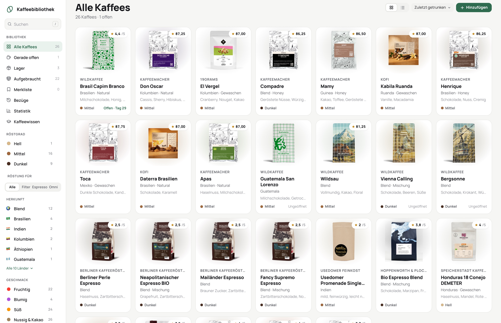

</div>

Most coffee apps are notebooks: enter a bean, give it stars, forget about it. Kaffeebibliothek starts where they stop.
It reads new coffees straight from the shop, pulls every grind from the grinder and every shot from the machine, joins them
into one brew and tells you where the grind setting has to go for the next shot. With reasons, in microns.

> The user interface is in German. This README and the [project page](https://yatheria030.github.io/kaffeebibliothek/en.html)
> are available in English; German terms from the app are given in quotes where they help you find your way.

## Contents

- [Highlights](#-highlights)
- [Features](#-features)
- [Integrations](#-integrations)
- [Under the hood](#-under-the-hood)
- [Quick start](#-quick-start)
- [Configuration](#%EF%B8%8F-configuration)
- [Backup and export](#-backup-and-export)
- [Development](#-development)
- [Privacy](#-privacy)
- [License](#-license)

## ✨ Highlights

- 🔎 **A coffee captured in seconds**: shop link, name or a photo of the bag, the Anthropic API fills in the rest. Live on screen
- ✂️ **Bag photos cut out automatically**: plain backgrounds removed, soft shadows kept, every bag the same size on the shelf
- 🧭 **Grind compass**: a starting point for every new bag on your grinder's scale, learning locally from your own brews
- ⚙️ **Grinder and machine log for you**: tuned for Mahlkönig E64 WS and Decent DE1, open to other machines and grinders, plus Home Assistant
- 📦 **Stock with drinking windows**: knows which bag to open next
- 📊 **SCA cupping, statistics and costs**: from a quick verdict to the full form, from price per cup to a world map
- 📚 **Coffee knowledge**: built-in wiki, linked to your coffees
- 🌗 **Light and dark**, from phone to 16" MacBook, installable as an app
- 🔒 **Everything stays with you**: one container, one SQLite file, one image folder

## 🧩 Features

### Library
- Shelf with cut-out bag images or a compact list, light and dark
- Views in the sidebar: **All**, **Open now**, **Stock**, **Finished**, **Wishlist**, **Archive**
- Filter by roast level, "roasted for" (filter, espresso, omni), country of origin, flavour and minimum score
- Search (<kbd>/</kbd>), sort by last brewed, best score, name, roast date or recently added
- "Recently viewed" in the sidebar, filters are remembered
- Add a coffee with the button or simply drop an image or link onto the page
- Wishlist for coffees you want to try: they move into the library with their first bag

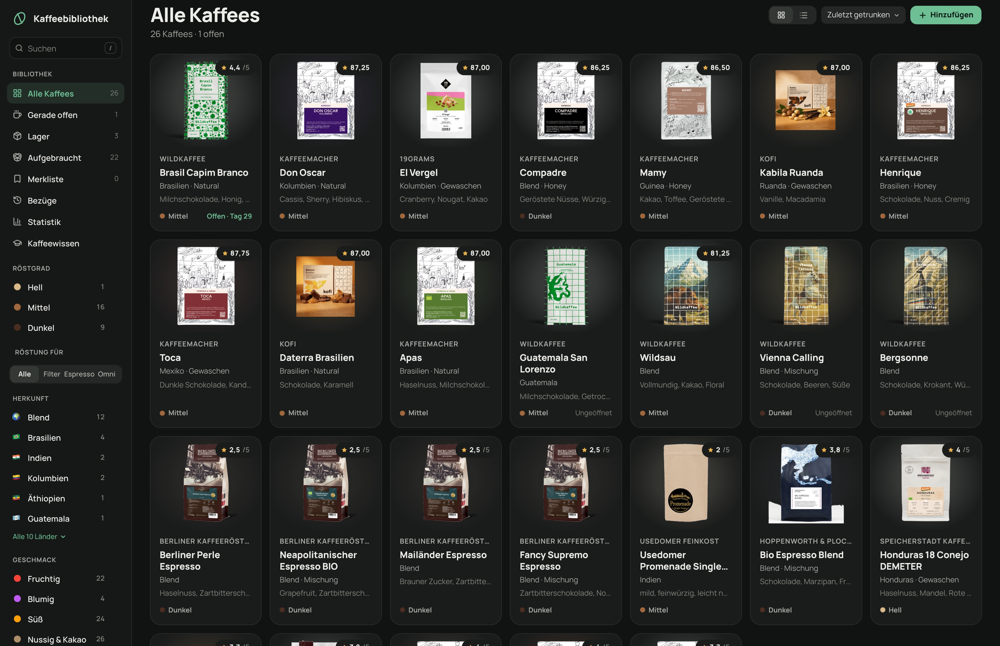

### Capturing a coffee
- Read in by **shop link, name or photo**: web search, pages read and finished fields appear live
- Captures roaster, origin (country, region, farm, producer, altitude), varieties, process with details (fermentation,
  drying, honey colour, decaf method), roast level, "roasted for", flavour notes, cup score, bag size and price
- Imports **roaster recipes** from the shop page
- Spellings of known roasters are merged ("Muster Coffee Roasters GmbH" = "Muster")
- **Bag images are cut out and aligned automatically**: plain background removed, shadows stay soft, all bags the same size.
  Fine-tune in the "Ausrichten" (align) editor with a guide grid
- Without an API key, everything works by hand

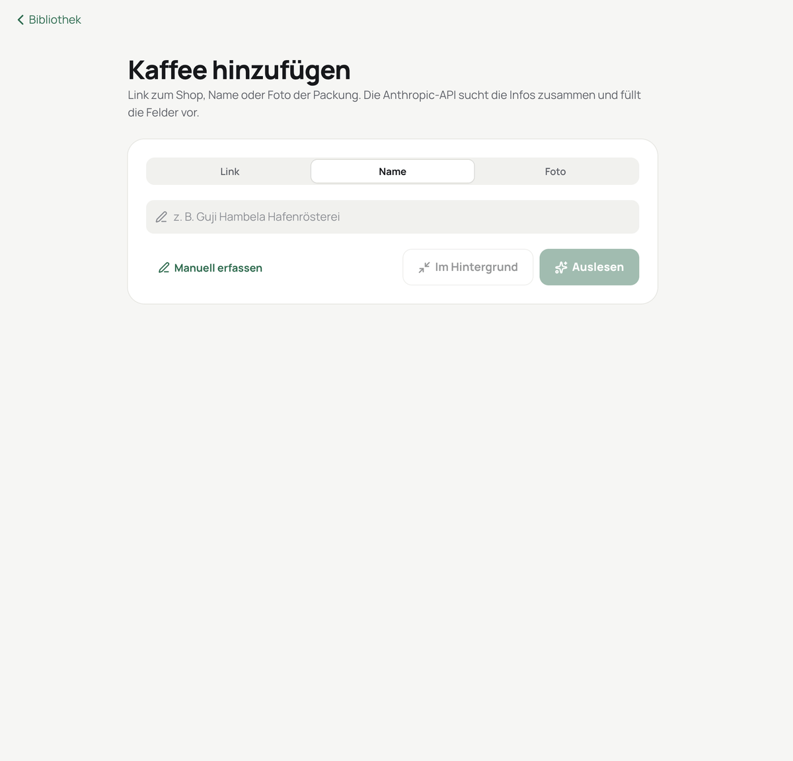

### Coffee detail
- Key figures: best score, brews, days since roast with freshness state, successful brews or average stars
- **Batches**: every bag with roast date, status (unopened, open, finished, back-filled), weight and price
- **Taste**: radar of the SCA attributes per recipe, or quick ratings with verdicts and flavour notes
- **Dial-in**: target, compass path, tip for the next shot, grind history across the bag
- **History** by roast age, brew time, temperature or ratio
- Details in groups (origin, bean, roast, purchase) with €/kg and price per cup
- Terms like process, variety, country and roast level link into the wiki
- A dedicated **Decent profile** per coffee (see [Integrations](#-integrations))

| Light | Dark |
|---|---|
| 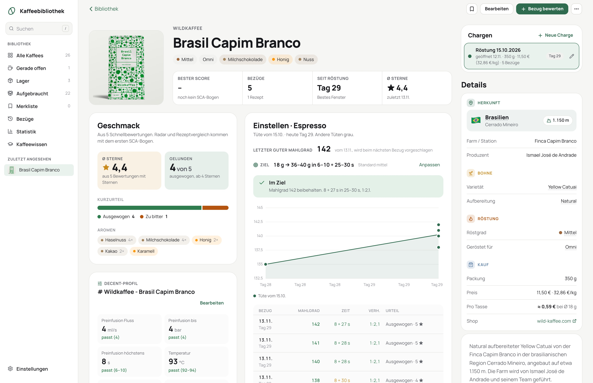 | 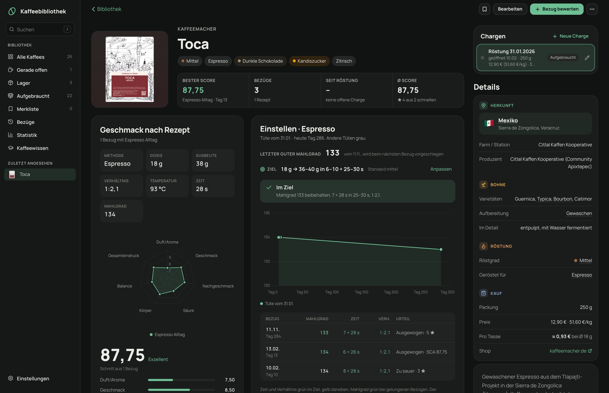 |

### Rating a brew
- Dialog in steps like at the machine: **recipe and parameters → grind → how did it run?**
- The grinder's grind and the machine's shot are taken over automatically and paired by time, with "undo"
- **Grind dial**: tape measure with momentum, tap to jump, mouse wheel, keyboard, ±1/±5 and jump chips (tip, last good, compass, last)
- **Shot analysis** for espresso: ratio, time, preinfusion and next grind setting shown large, with gauges against the target
  and a chart of every shot from this bag
- Rate **quickly** (verdict such as "balanced", "too sour", "too bitter", optional 1–5 stars, flavour notes) or with the
  **SCA cupping form** (7 attributes, uniformity, clean cup, sweetness, defects) including the **flavour wheel**
- Preinfusion is tracked separately from brew time ("8 + 29 s")
- Stars and SCA scores are counted separately, so quick ratings never water down scores

| Quick: verdict, stars, shot analysis | SCA form: score, tier, radar |
|---|---|
| 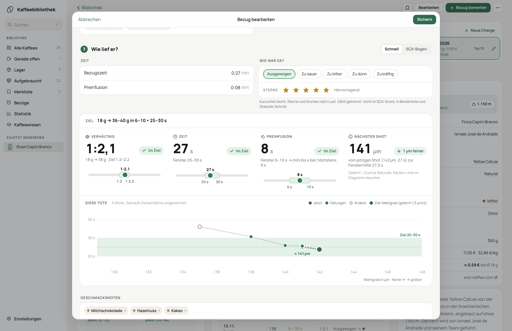 | 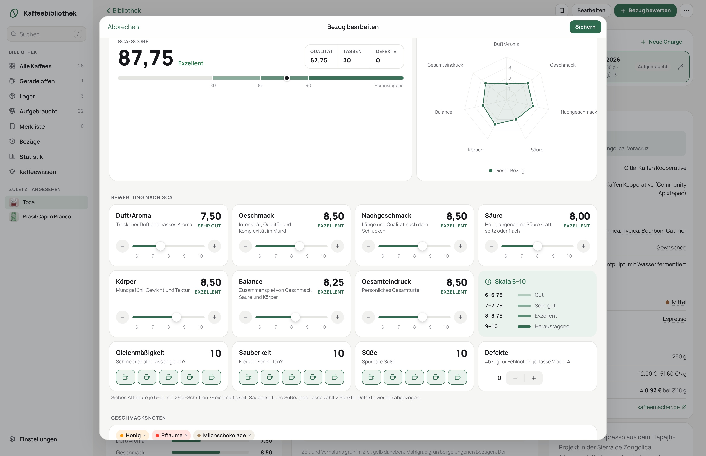 |
| **Grind dial and next shot** | **Flavour wheel (dark)** |
| 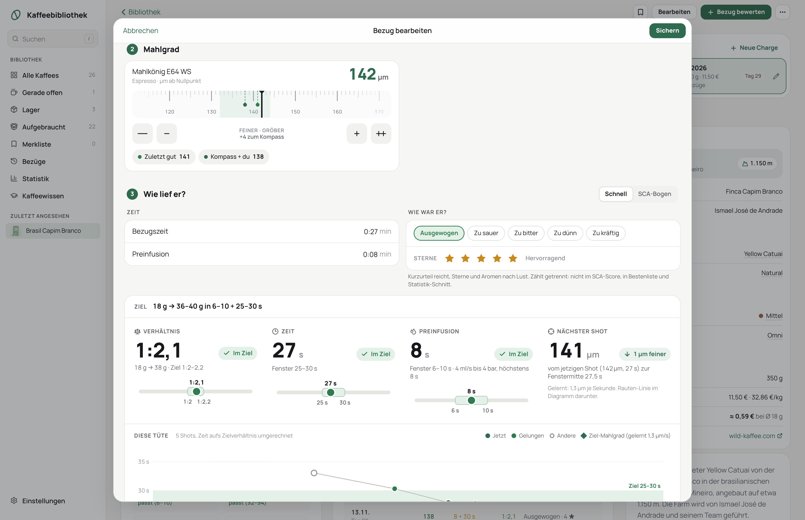 | 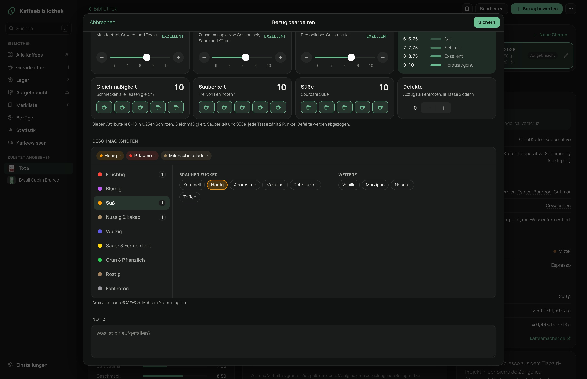 |

### Espresso target and grind compass
- **Target per roast level**: dose, ratio, time, preinfusion and temperature windows, adjustable per coffee field by field
- **Starting point for a new bag** on your grinder's scale from fixed rules: roast level, filter or espresso, altitude,
  process, decaf, robusta, roast age
- **Learns from your bags**: ridge regression over roast level, altitude, roast age, coffee, process, country, roaster and
  varieties, cross-validated bag by bag, fully local
- **Follows every shot**: time converted to the target ratio, translated into a grind setting via the learned slope (µm per second),
  accounting for beans ageing in the hopper
- Taste (sour, bitter) nudges the value per coffee, with a brake
- **Hints from fixed rules**: too fast, too slow, in the window and still sour, lengthen or shorten preinfusion
- Every number can be traced in the compass path

### Recipes
- Recipes as templates (method, grinder, dose, water or yield, temperature, grind, time)
- Recipe values are copied into the brew, deviations apply to that brew only
- Comparison by recipe: radar, attributes and score per recipe

### Stock and freshness
- All unopened bags with a **drinking window** (ready, best, still good) from researched roaster values
  for filter, espresso and omni × light, medium, dark, adjustable in the settings
- Sorted by urgency, **"open next"** at the top
- Without roast date, "roasted for" or roast level it says "not assessable", never a guess

| Light | Dark |
|---|---|
| 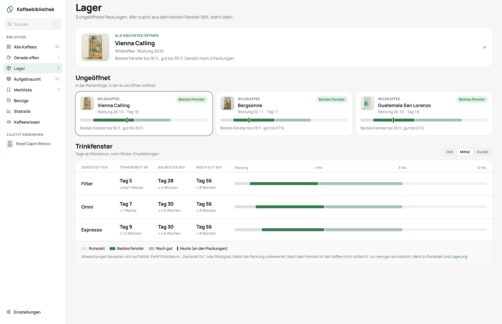 | 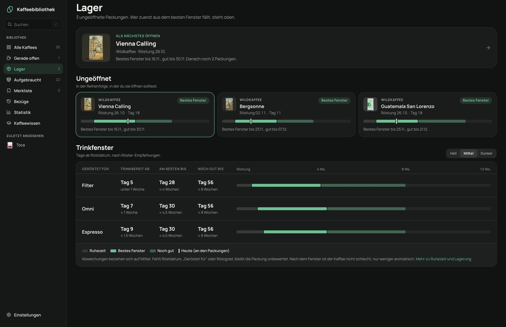 |

### Brews
- All brews across all coffees, grouped by day, with recipe, grind and shot
- **Deviation from the recipe** per value in percent (grind, dose, yield, time, temperature), green up to 5 %, red from 15 %
- "By recipe" tiles with average deviation filter the list
- Unassigned grinds from the last 90 days, so nothing gets lost

| Light | Dark |
|---|---|
| 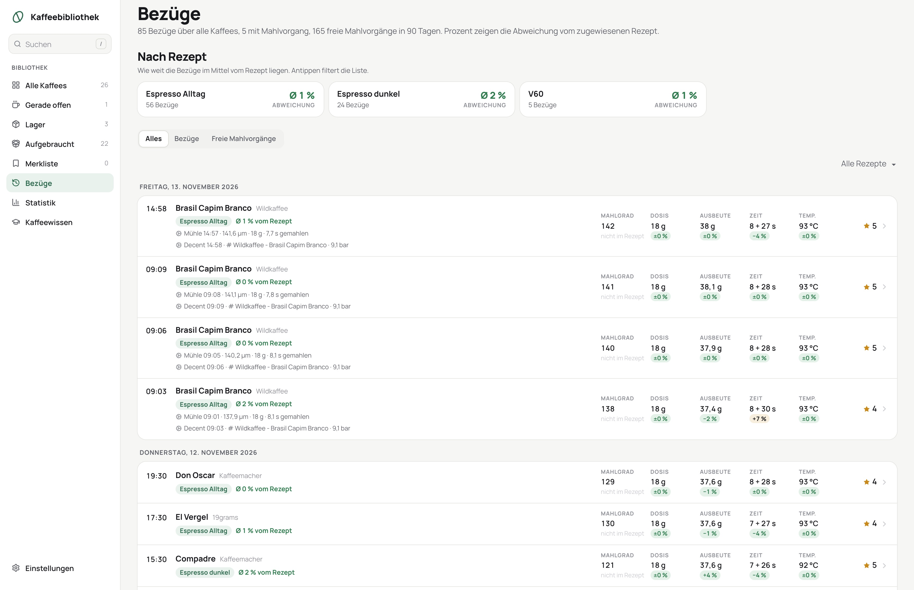 | 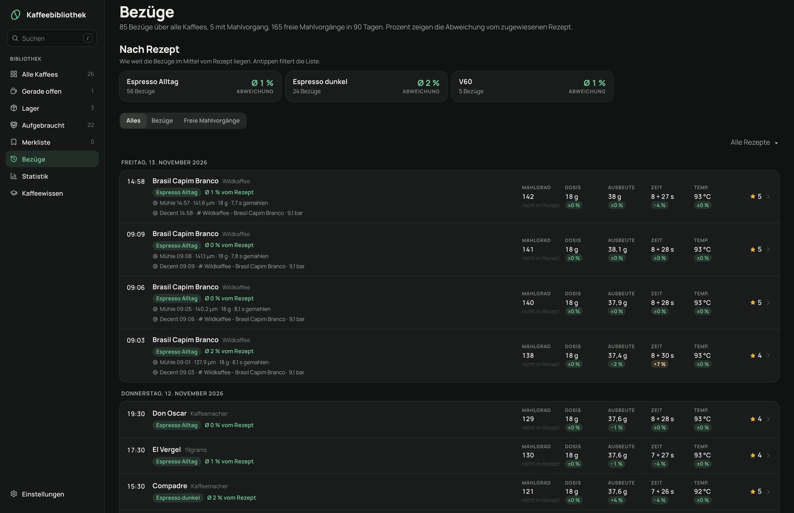 |

### Statistics
- Key figures: coffees, brews, average score, amount used
- Leaderboard, brews per month
- **Costs**: €/kg, price per cup, spending per month, price per roaster, "does expensive mean better?"
- Breakdown by origin (with a **world map**, click to filter the library), process, roast level and method
- **What suits me?**: a taste profile from your ratings. On request, the Anthropic API searches your roasters' shops for
  matching coffees, "add to wishlist" in one click

| Light | Dark |
|---|---|
| 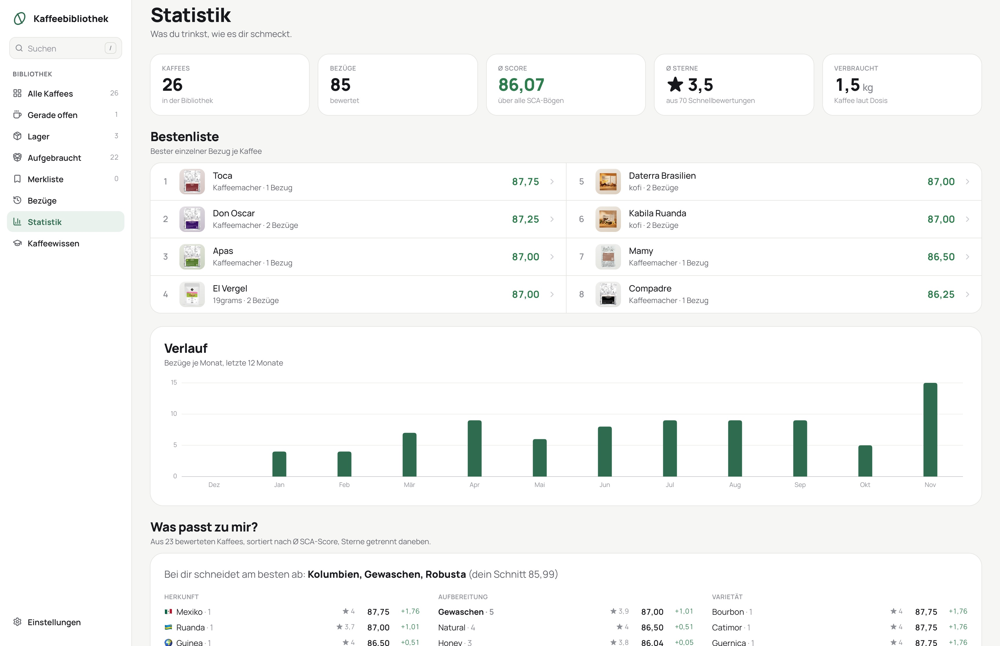 | 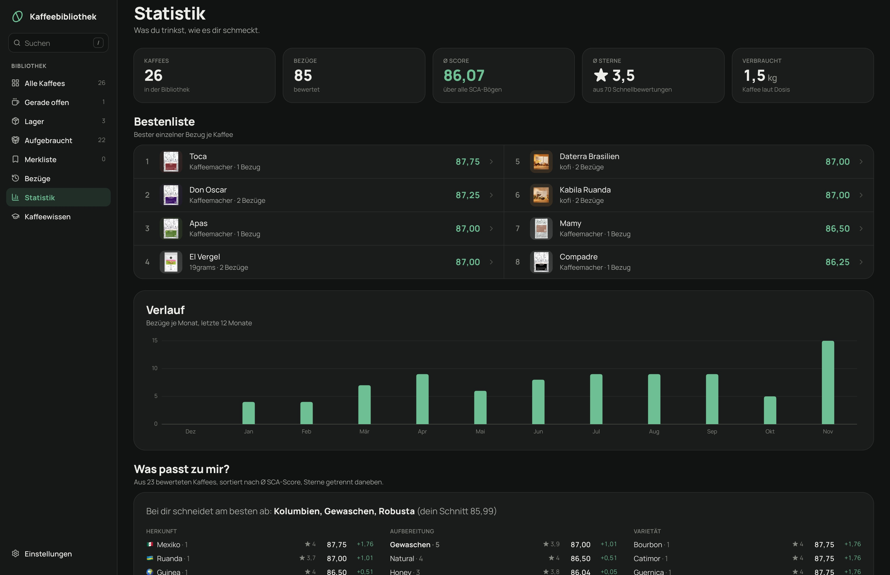 |

### Coffee knowledge
- Built-in wiki with more than 50 articles on basics, origin, varieties, processing, roasting, brewing and tasting
- Profile card and taste profile per article, matching coffees from your library
- SCA form, flavour wheel, resting time and grind compass read directly from the app's logic

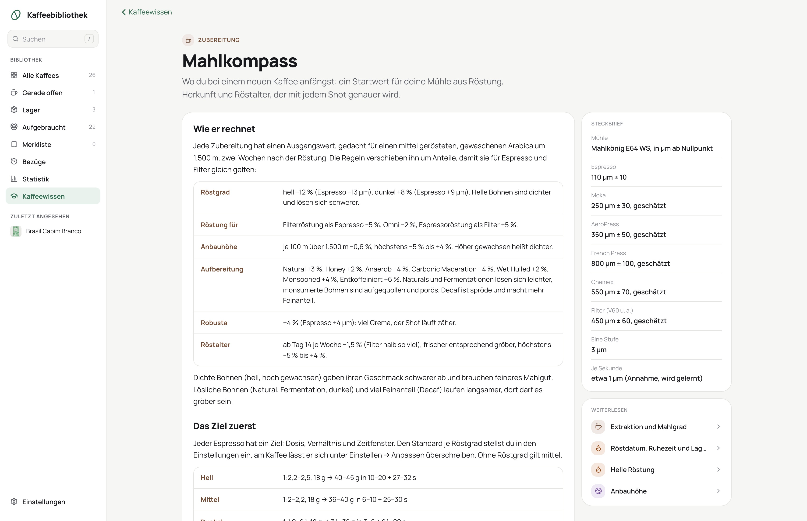

### Around the app
- **First steps**: a guided setup on first launch, walks through every setting (required, optional, recommended) with a summary
- **Settings** in sections: grinder, machine, espresso & recipes, stock & freshness, Anthropic API, data & backup, general
- **Installable** as an app (PWA) on phone and desktop
- **Dark mode** follows the system, layout from 390 to 1728 px wide
- Keyboard and focus handled with care: dialogs trap focus, <kbd>/</kbd> jumps to search

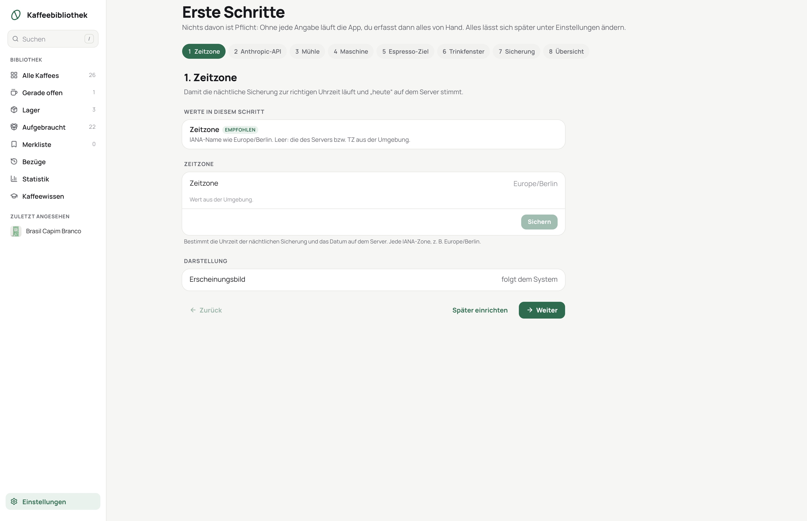

<p align="center">
  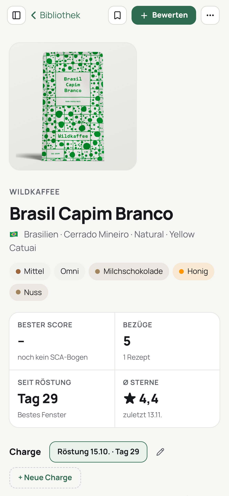
  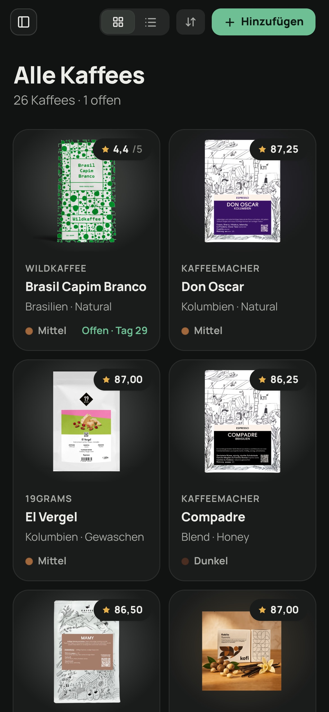
</p>

## 🔌 Integrations

All integrations are optional and set up in the settings.

> [!NOTE]
> **Built and tuned for the Decent DE1 and the Mahlkönig E64 WS**, because that is the setup it was developed with.
> The app is open to more: any espresso machine or grinder that can hand over its shots or grinds (an API, a local
> interface, an export or a Home Assistant integration) can be connected. Got one of those? Open an issue and let's add it.

| Integration | What it brings | How |
|---|---|---|
| **Anthropic API** | Read in coffees, fetch roaster recipes, "what suits me?" | API key in the settings, model selectable |
| **Mahlkönig E64 WS (home network)** | Every grind with setting, dose and duration | Enter the grinder's address. Read-only, nothing is changed on the grinder |
| **Mahlkönig Sync (cloud)** | Grinds via the cloud when grind-by-sync is used | Email, password, the store ID is found automatically |
| **Decent DE1** | Every shot with pressure, flow and weight curves, archive of all shots and profiles | Download the plugin as a ZIP from the settings and install it in the de1app |
| **Decent profile per coffee** | Preinfusion, temperature, pressure, stop weight and dose matching the target, synced with the tablet both ways | Automatic with the plugin. Existing profiles are never changed |
| **Home Assistant** | Temperatures, water level and state live, switch machine and steam | Address and token. Uses the entities of the de1app MQTT plugin |

## 🔬 Under the hood

What happens in the background so the front feels simple.

### Bag images
- **Automatic cut-out** in the browser (`web/src/lib/packshot.ts`): the background colour is estimated as the median of the border
  pixels, a flood fill from the edges collects everything matching it. Shadows are not cut hard but become semi-transparent
  black, so they look natural on any tile colour. If the fill runs too far into a light bag without an outline, the bag's
  interior is locked and the fill runs again
- **Automatic alignment**: the bag is found as the outline of the pixels that differ from the background and placed on a square
  image with fixed margins, so every bag on the shelf is the same size
- Remote images go through a server proxy that stores nothing, so the canvas is allowed to read them
- Images that are not cut out are blended into the tile with `mix-blend-mode: multiply` in light mode; cut-out ones are
  recognised by their transparent corners

### Reading in
- The Anthropic API response is passed to the UI as an **NDJSON stream**: web search, pages read and half-finished fields
  appear live, before the model is done
- Structured output through a tool (`save_coffee`), validated with zod. The model receives the known roasters so spellings match up
- Roaster names are compared without filler words (roastery, coffee, GmbH), spaces and accents; processes are normalised to
  consistent spellings

### Grind compass
- **Two layers**: fixed rules as a share of the grinder's base value, with a learned model on top that only learns the deviation
  from those rules. The very first bag is usable, and every further one makes it more precise
- **Ridge regression** over bags with a successful brew, each bag weighted equally. λ is chosen by **leave-one-bag-out**
  from 9 levels; the normal equations are built sparsely and solved once per bag for all λ. Below 3 bags, an average with
  half a bag of zero acts as a brake
- **Slope k** (µm per second) with a per-grinder prior, sharpened from shot pairs of the same bag. Days since the bag's first
  shot enter as a second variable, otherwise beans ageing in the hopper would skew k
- Brew times are converted to the target ratio, so a 1:2.3 and a 1:2 are comparable
- The learned model stays in memory until the database changes (`total_changes()` and `data_version`)

### Grinder and machine
- **Mahlkönig E64 WS on the home network**: the app downloads the grinder's SQLite database through its web interface and reads
  the grinds from it. Purges, idle runs and pre-grinding are filtered out by weight, throughput and portafilter detection
- **Pairing by time** (`shared/pairing.ts`): a shot takes the most recent open grind from the 15 minutes before it, with
  tolerance for clocks that differ. Pick one by hand and the other comes along
- **Decent plugin** in Tcl for the de1app: sends every shot after brewing, plus the whole archive (`history/`, `history_v2/`,
  profiles) with retries and a list of files already sent. The legacy Tcl shot format is parsed on the server
- Shot curves are thinned to at most 250 points; preinfusion is derived from the profile's state changes
- **Profiles both ways**: one profile per coffee, synced with the tablet, the newer change wins.
  The plugin only writes its own files and never changes an existing profile
- **Home Assistant**: the machine's entities are detected by pattern (state, temperatures, water, switches) and cached

### Data
- **SQLite via `node:sqlite`**, no native dependency. Migrations as SQL or as functions for data rewrites, state in `user_version`
- **Backups** as a hand-built ZIP (zlib), using `VACUUM INTO` for a consistent database snapshot while running
- **Settings** with a clear order: value in the app, else environment, else built-in default. Timers reschedule on change
- Keys and passwords never leave the server; the API only shows a hint such as `…a1b2`

### Interface
- React 19, TanStack Query, hash router. Links to a coffee prefetch its detail on hover, focus or touch
- **Container queries** instead of window width, so grids fit the actual column width
- Charts (radar, history, bars, shot curves) are custom SVG that measure their width instead of scaling, so text stays
  readable on a phone
- World map from world-atlas in the Equal Earth projection, loaded via dynamic import, country names via `Intl.DisplayNames`
- Crashed pages are caught by an error boundary, the sidebar stays usable
- Installable as a PWA, `index.html` uncached, hashed assets cached forever

## 🚀 Quick start

### Docker

```bash
git clone https://github.com/Yatheria030/kaffeebibliothek.git
cd kaffeebibliothek
docker compose up -d --build
```

Then open http://localhost:8790. `compose.yaml` stores the database and images in `./data` and the nightly backups
in `./backups`.

### Node

Requires Node 24.

```bash
npm ci
npm run build
npm start
```

On first launch, **first steps** ("Erste Schritte") opens. Nothing is required: the app runs without any input, you then
capture new coffees by hand.

## ⚙️ Configuration

All values live in the app's settings and are stored in the database. An empty field means default. Environment variables
only apply as long as nothing is set in the app.

| Value | Required? | Default | Environment | In the app |
|---|---|---|---|---|
| Time zone | recommended | server time zone | `TZ` | General |
| API key | optional, needed for reading in | – | `ANTHROPIC_API_KEY` | Anthropic API |
| Model | optional | `claude-opus-5-5` | `SCRAPE_MODEL` | Anthropic API |
| Your grinder (grind compass) | recommended | Mahlkönig E64 WS | – | Grinder |
| Grinder on the home network (address) | optional | – | `MAHLKOENIG_HOST` | Grinder |
| Mahlkönig Sync (email, password, store ID) | optional | – | `MAHLKOENIG_EMAIL`, `_PASSWORD`, `_STORE_ID` | Grinder |
| Sync every / period | optional | 10 min / 90 days | – | Grinder |
| Home Assistant (address, token) | optional | – | `HA_URL`, `HA_TOKEN` | Machine |
| Machine detection in HA | optional | `decent, de1` | – | Machine |
| Decent plugin | optional | – | – | Machine (download ZIP) |
| Espresso target per roast level | optional | built-in values | – | Espresso & recipes |
| Drinking windows | optional | researched roaster values | – | Stock & freshness |
| Nightly backup: folder | recommended | – (off) | `BACKUP_DIR` | Data & backup |
| Nightly backup: time / keep | optional | 02:30 / 14 | `BACKUP_KEEP` | Data & backup |

Environment only, because they must be known before the database:

| Variable | Default | Purpose |
|---|---|---|
| `DATA_DIR` | `data/` | Database `kaffee.db` and folder `images/` |
| `PORT` | `8790` | Port for API and UI |
| `HOST` | `0.0.0.0` | Address the server listens on |

## 💾 Backup and export

- **ZIP at the push of a button**: Settings → Data & backup → "ZIP laden" returns `kaffee.db`, `images/` and `kaffee.json`
- **Nightly**: with a folder set, the server writes `kaffee-YYYY-MM-DD.zip` every night at the chosen time and keeps the
  chosen number. If the last backup is older than 26 hours, one is made shortly after start
- **Export** of all data as JSON
- **Restore**: stop the server, unzip into the data folder (`DATA_DIR`), start

## 🛠 Development

```bash
npm run dev:server
```

```bash
npm run dev:web
```

Vite runs on :5180 and forwards `/api` and `/images` to the server on :8790. Check with `npm run typecheck`, build with
`npm run build` (into `dist/`, served by the server).

```
server/   Hono API, SQLite schema and migrations, reading in, grind compass, grinder, Decent, Home Assistant, backup
shared/   Types and domain logic for server and UI (SCA form, flavour wheel, freshness, espresso target, compass)
web/      React UI: pages in pages/, components in ui/, wiki content in lib/wiki.ts
docs/     Project page and screenshots
```

**Stack**: Hono on Node 24 (runs straight from TypeScript via tsx), `node:sqlite`, zod, React 19, Vite, Tailwind CSS 4,
TanStack Query. The grind models run without a library on the server; the Decent plugin is Tcl for the de1app.

## 🔒 Privacy

One container, one SQLite file, one image folder. No account, no tracking, no telemetry. Only what you switch on leaves
your network: the Anthropic API for reading in and recommendations, and optionally Mahlkönig Sync. The API never returns
passwords or tokens.

## 📄 License

[MIT](LICENSE)

The world map comes from [world-atlas](https://github.com/topojson/world-atlas) (Natural Earth 1:110m, public domain),
projected in Equal Earth.
